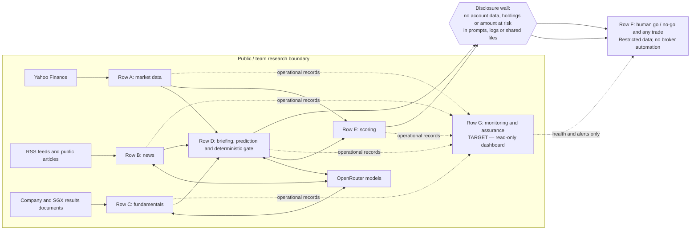
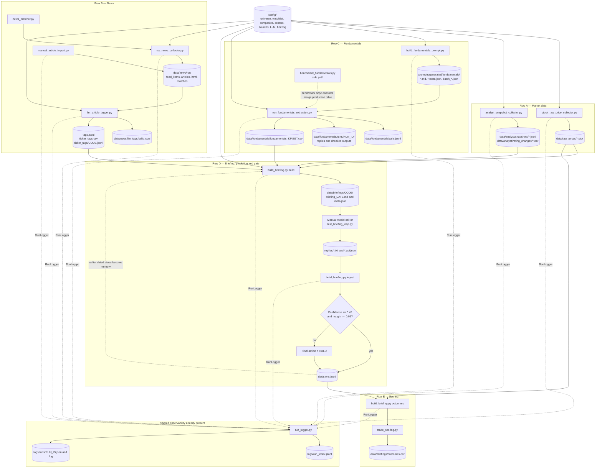
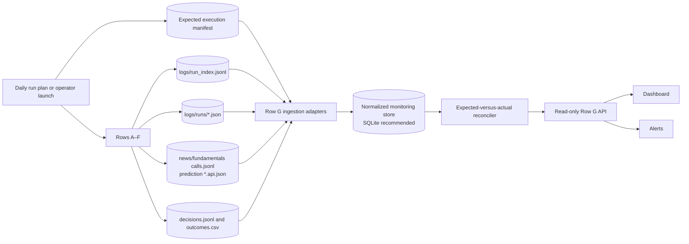
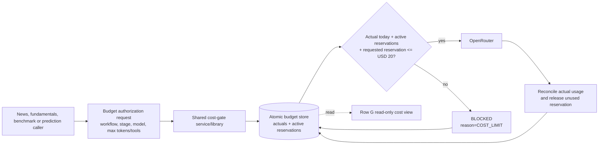
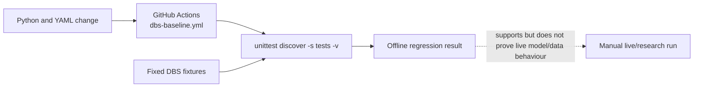

# Stock Agentic Workflow — End-to-End Architecture

**Architecture baseline:** repository snapshot supplied in `Stock-Agentic-Workflow-main`  
**Prepared:** 9 November 2026 (SGT)  
**Purpose:** describe the implemented A–F workflow from source files to scored decisions, then define the target Row G monitoring and cost-control architecture without presenting planned controls as already built.

---

## 1. Executive view

The repository is a **file-oriented, Python-based research workflow** for Singapore-listed stocks. It is not a trading platform and has no broker integration.

The implemented path is:

1. **Row A — Market data:** collect prices, the STI benchmark, and dated analyst snapshots.
2. **Row B — News:** collect or import articles, match them to companies, and use an LLM to tag relevance, materiality, sentiment, event type, confidence, and evidence.
3. **Row C — Fundamentals:** generate extraction prompts, call an LLM, validate returned KPI rows in code, and merge usable rows into a governed table.
4. **Row D — Briefing and prediction:** join only point-in-time inputs into a dated briefing; send the briefing to a reasoning model; validate and ingest its BUY/HOLD/SELL probabilities.
5. **Row E — Scoring:** after the 20-trading-day horizon closes, compare the call with the realised stock return versus the STI and calculate classification and simulated BUY-return metrics.
6. **Row F — Human decision:** keep holdings, account details, amount at risk, and any live-trade decision outside prompts, logs, and shared files.
7. **Row G — Monitoring:** specified but not implemented in the supplied repository. The target design below reads operational records, reconciles expected versus actual stages, displays failures and missing runs, and observes a pre-call cost gate.

### The most important architecture distinction

- **Implemented evidence:** Python scripts, YAML configuration, generated files, run logs, call logs, decision ledgers, outcome scoring, offline tests, and CI.
- **Designed evidence:** the Row G dashboard, expected-stage reconciliation, unattended daily orchestration, and a workflow-wide projected-cost gate.
- **External control:** the stated USD 20 daily OpenRouter account limit is outside this repository. The repository’s fundamentals configuration currently has a **USD 25 per-run** threshold, which is not the same as a USD 20 workflow-wide daily hard cap.

---

## 2. System context and boundary wall



### Boundary rules

| Boundary | Rule |
|---|---|
| Public research boundary | Prices, public news, company reports, model outputs, and team-created research records may be processed above the wall. |
| Disclosure wall | Holdings, account balances, position concentration, available capital, and amount at risk must not enter prompts, operational logs, shared evidence files, or the dashboard. |
| Decision authority | A model recommendation and a deterministic gate produce research outputs only. A named human makes the live go/no-go decision. |
| Monitoring authority | Row G reads evidence and raises status; it must not alter research outputs or place trades. |

---

## 3. As-is component architecture



### What this diagram deliberately does not claim

- There is no supplied web dashboard or Row G API.
- There is no supplied master daily orchestrator that creates one execution ID for all rows.
- `test_briefing_loop.py` calls OpenRouter directly and saves API usage in a reply-side `.api.json`; it does not use `RunLogger` for the outer prediction loop.
- The workflow is started manually today. The GitHub Actions workflow runs offline tests, not the live daily pipeline.
- No component sends an order to a broker.

---

## 4. End-to-end execution sequence

```mermaid
sequenceDiagram
    autonumber
    actor Operator
    participant A as Row A collectors
    participant B as Row B news pipeline
    participant C as Row C fundamentals pipeline
    participant D as Briefing builder
    participant L as Reasoning LLM
    participant Gate as Deterministic ingest gate
    participant E as Outcome scorer
    participant Log as Run and call logs
    participant G as Row G target monitor
    actor Owner as Human decision owner

    Operator->>A: Refresh prices and analyst snapshots
    A->>Log: Write per-script run records
    A-->>D: Price XLSX and analyst JSONL/CSV

    Operator->>B: Poll/import, match and tag news
    B->>L: Article tagging calls
    L-->>B: Structured tags and usage
    B->>Log: Write run records and calls.jsonl
    B-->>D: Per-stock ticker_tags JSONL

    opt Results period update
        Operator->>C: Build batch and run extraction
        C->>L: KPI extraction call
        L-->>C: CSV-like result and usage
        C->>C: Validate headers, numbers, ranges and ratios
        C->>Log: Write run records and calls.jsonl
        C-->>D: Merge usable KPI rows only
    end

    Operator->>D: Build for stock and as-of date
    D->>D: Apply point-in-time filters and freshness checks
    D->>Log: Write build record and metadata
    D-->>L: Dated briefing prompt
    L-->>D: BUY/HOLD/SELL probabilities and rationale
    D->>Gate: Ingest saved reply
    Gate->>Gate: Parse, normalise and apply confidence/margin rule
    Gate->>Log: Write ingest record
    Gate-->>E: Append dated decision ledger row

    Note over E: Wait until 20-trading-day outcome exists
    Operator->>E: Recompute outcomes
    E->>E: Score versus STI and 0.6-point BUY cost assumption
    E->>Log: Write outcome run record
    E-->>Owner: Research evidence and scored results

    par Target monitoring
        Log-->>G: Run index, per-run JSON, API calls and artefacts
        G->>G: Reconcile expected versus actual stages
        G-->>Owner: Missing, failed, stale and spend alerts
    end

    Owner->>Owner: Human go / no-go; restricted information remains below wall
```

---

## 5. Repository-to-runtime map

### 5.1 Control plane

| Repository path | Role | Main consumers |
|---|---|---|
| `config/universe.yaml` | Price universe and sector mapping; includes the STI benchmark. | Price collector, briefing builder, prompt builders. |
| `config/watchlist.yaml` | Full research watchlist; supplied snapshot contains DBS, OCBC, and UOB. | News, analyst, fundamentals, briefing workflows. |
| `config/companies/` | Company names, aliases, domains, and context. | News matcher and prompt builders. |
| `config/sectors/` | Sector-level news guidance. | News-sweep prompt builder. |
| `config/news_sources.yaml` / `.csv` | Feeds, domains, source attributes, and trust metadata. | News collection and briefing source-tier display. |
| `config/llm.yaml` | News-tagger model, fallbacks, token and request controls. | `llm_article_tagger.py`. |
| `config/fundamentals/` | KPI sets, company profiles, extraction settings, benchmark settings. | Fundamentals prompt, extraction, and benchmark scripts. |
| `config/briefing.yaml` | Horizon, benchmark, freshness warnings, memory, decision gate, and experiment profiles. | `build_briefing.py`. |
| `prompts/templates/` | Jinja2 templates for news sweep and fundamentals extraction. | Prompt builders. |

### 5.2 Execution plane

| Stage | Code entrypoint | Primary input | Primary output |
|---|---|---|---|
| A1 Price collection | `stock_raw_price_collector.py` | Yahoo Finance + configured universe | `data/raw_prices/*.xlsx` |
| A2 Analyst collection | `analyst_snapshot_collector.py` | Yahoo Finance + watchlist/universe | `data/analyst/snapshots/*.jsonl`, `rating_changes/*.csv` |
| B1 News collection | `rss_news_collector.py` | RSS/sitemaps + source config + watchlist aliases | `data/news/rss/` and per-stock matches |
| B2 Manual import | `manual_article_import.py` | Saved HTML/MHTML files | Same news storage contract as the RSS path |
| B3 Company matching | `news_matcher.py` | Titles/text + company alias profiles | Match records used by collection/tagging |
| B4 News tagging | `llm_article_tagger.py` | Matched articles + LLM config | Call log, tags, per-stock tag files |
| C1 Fundamentals prompt | `build_fundamentals_prompt.py` | KPI definitions, company profiles, existing master table | Generated prompts, metadata, batch file |
| C2 Fundamentals extraction | `run_fundamentals_extraction.py` | Batch + PDFs or web mode + OpenRouter | Call log, saved replies, checked run output, merged KPI table |
| C3 Model benchmark | `benchmark_fundamentals.py` | Fixed answer key + same documents | Benchmark leaderboard and cell-level results; no production merge |
| D1 Briefing build | `build_briefing.py build` | A, B, C artefacts + prior decisions | Dated Markdown briefing and metadata sidecar |
| D2 Prediction | Manual call or `test_briefing_loop.py` | Dated briefing | Saved model reply and API metadata |
| D3 Gate and ledger | `build_briefing.py ingest` | Briefing metadata + saved reply | `decisions.jsonl` with model and final action |
| E Scoring | `build_briefing.py outcomes` + `trade_scoring.py` | Decisions + price history + STI | `outcomes.csv` |
| Shared run logging | `run_logger.py` | Per-script execution context | Per-run JSON/log and `logs/run_index.jsonl` |
| Offline verification | `tests/` + `.github/workflows/dbs-baseline.yml` | Fixed DBS fixtures | Unit/integration result; no live API call |

### 5.3 Evidence plane

| Evidence object | What it proves | Limitation |
|---|---|---|
| `logs/run_index.jsonl` | A script reached `RunLogger.__exit__`, with status and summary. | It cannot prove that an expected script was launched; absence has no row. |
| `logs/runs/<run_id>.json` | Parameters, issues, items, environment, error, status, and file pointers for one script execution. | Run IDs are script-specific, not one shared daily workflow ID. |
| `data/news/llm_tags/calls.jsonl` | Model, provider, tokens, reported cost, latency, HTTP status, and call linkage for news tagging. | Not a workflow-wide cost ledger. |
| `data/fundamentals/calls.jsonl` | Model, provider, tokens, tools, cost, and status for fundamentals calls. | Per-run budget check occurs only after reported cost reaches the threshold. |
| `replies/*.api.json` | Prediction API usage returned by OpenRouter. | Stored separately from the other cost logs; no unified enforcement. |
| Briefing `.meta.json` | As-of date, input summaries, configuration hash, briefing hash, and other provenance. | A warning is not always a hard stop; stale news/fundamentals remain a known seam. |
| `decisions.jsonl` | Model probabilities, model action, gated action, gate reason, configuration/briefing hashes, and rationale fields. | Research ledger only; not proof that a human traded. |
| `outcomes.csv` | Realised bucket, hit, Brier score, base-rate comparison, and simulated BUY-return fields. | Only complete after the horizon closes; simulated returns are not live execution evidence. |

---

## 6. Row-by-row architecture and stop points

| Row | Producer | Handoff contract | Current stop/fallback behaviour | State |
|---|---|---|---|---|
| A — Market data | Price and analyst collectors | Price workbook per ticker; dated analyst snapshot/rating-change files | Collector records per-ticker failures. Briefing build stops when no price exists; supplied dossier states a stricter expected-trading-day freshness stop is part of the operating version. | Built; live public data |
| B — News | RSS/manual collection, matcher, LLM tagger | Article/match records followed by per-stock structured tags and call records | Sponsored/duplicate/no-text items are skipped by rules; model circuit breaker and fallback exist. Source/quote blocking is not fully switched on in the supplied baseline. | Built; live public data, with governance gaps |
| C — Fundamentals | Prompt builder and extraction runner | KPI table with release date plus prompts, replies, validations and call records | Unusable extraction is not merged. Per-run cost threshold stops before a later call only after accumulated reported cost has reached the threshold. | Built on lead extraction path; governed sub-agent extensions planned |
| D — Briefing/prediction/gate | Briefing builder, external model, ingest command | Dated briefing + metadata; reply; decision-ledger row | Point-in-time filters; invalid/incomplete probability reply rejected; low-confidence or low-margin non-HOLD call converted to HOLD. | Built; weakest data-freshness seam remains |
| E — Scoring | Outcome and trade-scoring code | `outcomes.csv` | Scores only when the 20-day window is complete; BUY simulation subtracts 0.6 percentage points and compares with STI. | Built; offline tests |
| F — Human decision | Named human owner | Go/no-go record outside public AI pipeline | No trade without human decision; no broker automation. | Human process |
| G — Monitoring | Target dashboard/API | Expected manifest + actual run/call/artefact records | Missing/failed/stalled/stale/cost exception displayed; does not change evidence. | Designed, not built |

---

## 7. Critical seams

### 7.1 Seam map

| Seam | Failure mode | Existing evidence/check | Required Row G treatment |
|---|---|---|---|
| A → D: price/benchmark | Old or wrong-date stock/STI close enters a current briefing. | Price dates and build metadata; freshness checks. | Hard red status when actual close date differs from expected SGX trading date. |
| B collector → tagger | Article is not tagged, is tagged after cut-off, or changes after tagging. | Match/tag records, prompt/model version, article/call IDs. | Compare matched article count with tagged count at cut-off; require content hash in the final contract. |
| B → D: news evidence | Low-trust or unverified evidence influences a briefing. | Source tier and evidence verification fields exist in tag/briefing logic. | Display blocked/warned counts and policy version; do not infer trust from absence. |
| C → D: fundamentals | New results are available but table remains on the prior period; invalid cell changes basis. | Release dates, extraction validations, changes log, master table. | Calculate days since release/update and expected latest period; red when a required quarter is absent. |
| D input join | A, B, or C is stale but looks like a quiet day. | Metadata and warnings; seam tests found this is the weakest junction. | Expected-input contract per briefing, with hard distinction between `QUIET` and `MISSING/STALE`. |
| D model → gate | Reply is malformed, probabilities are incomplete, or stated action differs from argmax. | Ingest parsing, normalisation, warnings, deterministic gate. | Show `REJECTED` and verify no ledger row was appended for malformed input. |
| D → E | Predictor owner is also the scorer or outcomes are recomputed inconsistently. | Deterministic scoring and offline tests. | Record scorer version/hash and independent re-run timestamp. |
| A–F → G | A stage never starts and therefore writes no error. | No complete solution in current repository. | Reconcile an expected-stage manifest against actual events; synthesize `MISSING`. |
| API callers → cost control | Current spend is below cap, but the next call causes an overshoot. | Per-call usage is stored, but controls are fragmented. | Reserve a conservative next-call amount before transmission; reject when projected spend exceeds cap. |

### 7.2 Weakest seam

The join into `build_briefing.py` is the weakest seam because data from separate clocks and owners can be syntactically valid but stale. A quiet news day and a failed news run can otherwise look identical. The architecture must therefore carry both:

- **business content** — prices, tags, KPI rows, analyst snapshots; and
- **operational provenance** — expected stage, actual status, as-of date, cut-off, source version, artefact path/hash, and validation result.

Row G must never determine “healthy” merely because a file exists.

---

## 8. Target Row G monitoring architecture

### 8.1 Design principle

Row G is a **reader and reconciler**, not the owner of A–F outputs. It has two inputs:

1. **Expected:** what should run for a trading date and stock scope.
2. **Actual:** run events, artefacts, freshness, decisions, and call costs that were actually recorded.



### 8.2 Required correlation key

The current `RunLogger` creates a separate `run_id` for each script. Add a parent key without removing the existing IDs:

- `workflow_run_id`: one daily end-to-end execution, for example `WF-20261109-CLOSE-001`.
- `stage_run_id`: the existing per-script `run_id`.
- `trade_date`: the SGX decision date.
- `scope`: full universe, watchlist, or a named stock subset.
- `stage_id`: stable stage name such as `A_PRICE`, `B_NEWS_TAG`, or `D_INGEST`.

Propagate `workflow_run_id` through command arguments or an environment variable and write it into every per-run JSON, call record, briefing metadata record, API record, and ledger row.

### 8.3 Expected execution manifest

```json
{
  "workflow_run_id": "WF-20261109-CLOSE-001",
  "trade_date": "2026-11-09",
  "timezone": "Asia/Singapore",
  "scope": {
    "price_universe": "config/universe.yaml",
    "research_watchlist": "config/watchlist.yaml"
  },
  "expected_stages": [
    {"stage_id": "A_PRICE", "required": true, "deadline": "17:30:00"},
    {"stage_id": "A_ANALYST", "required": true, "deadline": "17:40:00"},
    {"stage_id": "B_NEWS_COLLECT", "required": true, "deadline": "17:45:00"},
    {"stage_id": "B_NEWS_TAG", "required": true, "deadline": "18:00:00"},
    {"stage_id": "C_FUNDAMENTALS", "required": false, "condition": "results_due"},
    {"stage_id": "D_BUILD", "required": true, "deadline": "18:10:00"},
    {"stage_id": "D_PREDICT", "required": true, "deadline": "18:25:00"},
    {"stage_id": "D_INGEST", "required": true, "deadline": "18:30:00"},
    {"stage_id": "E_SCORE", "required": true, "condition": "matured_calls_exist"},
    {"stage_id": "F_REVIEW", "required": true, "deadline": "next_market_open"}
  ]
}
```

The times above are design examples and must be confirmed by the operators. The architecture requirement is the explicit manifest, not those exact times.

### 8.4 Normalized stage event

```json
{
  "workflow_run_id": "WF-20261109-CLOSE-001",
  "stage_run_id": "build_briefing_20261109_181005",
  "stage_id": "D_BUILD",
  "trade_date": "2026-11-09",
  "status": "SUCCESS",
  "started_at": "2026-11-09T18:10:05+08:00",
  "ended_at": "2026-11-09T18:10:34+08:00",
  "issues": {"INFO": 0, "WARNING": 0, "ERROR": 0},
  "scope": {"stocks": ["D05", "O39", "U11"]},
  "artifacts": [
    {
      "type": "briefing_meta",
      "path": "data/briefings/D05/briefing_D05_2026-11-09.meta.json",
      "sha256": "..."
    }
  ],
  "freshness": {
    "stock_close_date": "2026-11-09",
    "sti_close_date": "2026-11-09",
    "latest_news_at": "2026-11-09T17:55:00+08:00",
    "latest_fundamental_release": "2026-11-06"
  }
}
```

### 8.5 Reconciliation logic

For every manifest stage:

```text
if no actual stage event exists after the stage deadline:
    status = MISSING
elif actual status == FAILED:
    status = FAILED
elif stage is still STARTED after max duration:
    status = STALLED
elif required artefact is absent or hash cannot be verified:
    status = INVALID_ARTIFACT
elif freshness contract fails:
    status = STALE
elif warnings exist:
    status = WARNING
else:
    status = SUCCESS
```

Overall workflow health is the maximum severity across required stages:

```text
FAILED / MISSING / STALLED / INVALID_ARTIFACT / STALE  -> RED
WARNING / BLOCKED_BY_BUDGET                            -> AMBER
all required stages SUCCESS                           -> GREEN
```

A budget block is amber rather than red only when the architecture intentionally stops safely before an optional model call. If it prevents a required daily decision from completing, the workflow result is red/incomplete.

### 8.6 Dashboard views

1. **Today:** expected stage cards A–F, actual status, duration, deadline, artefact count, and exception.
2. **Run history:** one row per `workflow_run_id`, not one row per script.
3. **Logs and evidence:** drill-down to per-run issues and artefact metadata.
4. **Freshness:** price/STI dates, latest tagged news, latest fundamentals release/table period, analyst snapshot age.
5. **Decision:** per-stock model probabilities, model action, final gated action, gate reason, and ledger link.
6. **Cost:** actual spend, reservations, projected spend, daily cap, per-stage/provider/model breakdown.
7. **Alerts:** open/acknowledged/closed exception records with owner and cold reader.
8. **Test evidence:** latest offline CI result, Row G seam-test result, and exact tested version.

---

## 9. Cost monitoring and enforcement

### 9.1 What exists in the supplied files

| API path | Cost evidence | Existing control |
|---|---|---|
| News tagging | `data/news/llm_tags/calls.jsonl` stores reported `cost`; run summary totals it. | Free-model request controls, fallbacks, circuit breaker, maximum calls per run. No USD daily gate in the supplied tagger. |
| Fundamentals extraction | `data/fundamentals/calls.jsonl` stores reported `cost`; run summary totals it. | `max_cost_usd_per_run: 25`; the next prompt is skipped only when accumulated reported cost is already at/above the threshold. |
| Fundamentals benchmark | Benchmark-local call records and leaderboard. | `max_cost_usd: 5`; check is between model calls. |
| Prediction loop | Reply-side `.api.json` stores OpenRouter usage. | Token ceiling and retry controls. No workflow-wide daily cap in the supplied script. |
| OpenRouter account | Usage page/account limit. | Dossier states USD 20 daily external limit; not enforced by repository code. |

### 9.2 Current control gap

Checking only:

```python
if current_spend >= 20:
    stop()
```

cannot guarantee a USD 20 ceiling. If current spend is USD 18 and the next call costs USD 5.67, the check passes before the request and total spend becomes USD 23.67 afterward.

The supplied fundamentals runner has the same class of issue at its per-run threshold: it compares **reported cost already spent** with the configured threshold before the next prompt. It does not reserve the maximum permitted cost of the pending call.

There is also a policy mismatch to resolve:

```text
Workflow daily cap stated in dossier: USD 20
Fundamentals max_cost_usd_per_run: USD 25
Benchmark max_cost_usd: USD 5
Prediction loop: no repository cost cap
News tagger: no USD cap; configured to free models
```

### 9.3 Target pre-call cost gate

The enforcement point must sit in front of every OpenRouter call, not in the dashboard.



### 9.4 Atomic reservation algorithm

Use SQLite or another transactional store; do not rely on multiple processes appending and summing JSONL without a lock.

```text
BEGIN IMMEDIATE TRANSACTION

actual_today = SUM(actual_cost_usd where Singapore date = today)
reserved_today = SUM(reserved_usd where state = ACTIVE)
requested = conservative maximum for the pending call

if actual_today + reserved_today + requested > daily_cap:
    write BLOCKED authorization event
    ROLLBACK / COMMIT block record
    do not transmit the API request
else:
    write ACTIVE reservation with expiry
    COMMIT
    transmit request
    on response: write actual cost and release reservation
    on timeout/unknown billing: keep reservation until reconciled or expired by policy
```

### 9.5 Cost event contract

```json
{
  "cost_event_id": "CE-20261109-00042",
  "workflow_run_id": "WF-20261109-CLOSE-001",
  "stage_id": "D_PREDICT",
  "call_id": "provider-generation-id-or-local-id",
  "provider": "openrouter",
  "model": "model-id",
  "event": "RECONCILED",
  "reserved_usd": 1.5,
  "actual_cost_usd": 0.42,
  "daily_cap_usd": 20.0,
  "currency": "USD",
  "at": "2026-11-09T18:20:14+08:00"
}
```

### 9.6 Warning policy

| Projected utilisation | Row G display | Enforcement |
|---:|---|---|
| Below 80% | Green | Calls may proceed if reservation fits. |
| 80% to below 90% | Amber warning | Calls may proceed if reservation fits. |
| 90% to below 100% | High warning | Prefer only required calls; reservation still mandatory. |
| Pending reservation would exceed 100% | `BLOCKED_BY_BUDGET` | No request sent. |
| Actual/provider reconciliation exceeds cap | Red control incident | Freeze further calls, reconcile provider records, and record why the reservation was insufficient. |

The dashboard observes this control. It is not the component that blocks the network call.

---

## 10. Suggested Row G monitoring rules

These rules operationalize the supplied dashboard concept. They should be mapped to the team’s official MON-01–MON-10 wording before being labelled as the official rules.

| Suggested rule | Trigger | Dashboard result | Required action/evidence |
|---|---|---|---|
| Expected stage missing | No event after deadline | Red `MISSING` | Record expected manifest and absence; named owner investigates. |
| Stage failed | Per-run status `FAILED` or error | Red `FAILED` | Link the per-run JSON/log and error. |
| Stage stalled | STARTED exceeds maximum duration | Red `STALLED` | Capture last heartbeat/event and stop/recover decision. |
| Required artefact invalid | File absent, unreadable, or hash mismatch | Red `INVALID_ARTIFACT` | Identify producer and consumer; do not treat downstream stage as healthy. |
| Market data stale | Stock or STI close date differs from expected SGX date | Red `STALE_PRICE` | Stop briefing/prediction for affected stock. |
| Research input stale/incomplete | News/fundamentals contract fails | Red or amber by policy | Distinguish a verified quiet period from a failed producer. |
| Spend warning | Actual + active reservations >= 80% cap | Amber | Show actual/reserved/projected and contributing calls. |
| Cost gate blocks call | Pending reservation would exceed cap | Amber/red by stage criticality | Store a block event proving no API request was sent. |
| Cost records disagree | API metadata, call logs, and provider usage do not reconcile | Red control incident | Freeze further calls until reconciled. |
| Decision evidence incomplete | Required briefing, reply, ledger row, score, or human review absent | Red `INCOMPLETE` | Show exact missing evidence and accountable owner. |

---

## 11. Row G seam-test plan

| Test | Fault injected | Expected result |
|---|---|---|
| RG-T01 Missing stage | Omit `B_NEWS_TAG` entirely. | Dashboard synthesizes `MISSING`; overall workflow is red even though no error log exists. |
| RG-T02 Failed stage | Create a `FAILED` run record for fundamentals extraction. | Red stage with error link; downstream D cannot be shown green without an explicit exception policy. |
| RG-T03 Stalled stage | Write STARTED but no terminal event. | `STALLED` after threshold, not “running forever.” |
| RG-T04 Missing artefact | Record success but remove the declared briefing metadata file. | `INVALID_ARTIFACT`; success record alone is insufficient. |
| RG-T05 Stale market date | Supply stock or STI close older than expected SGX date. | `STALE_PRICE`; briefing/prediction blocked. |
| RG-T06 Quiet-versus-failed | Produce zero matched news with successful collector/tagger evidence, then repeat with no collector run. | First case `QUIET/SUCCESS`; second case `MISSING/RED`. |
| RG-T07 80% warning | Set actual + reserved to USD 16 of USD 20. | Amber warning; values and contributing calls displayed. |
| RG-T08 Projected overspend | Set actual to USD 18.20 and request a USD 3.50 reservation. | Authorization blocked before network transmission; `COST_LIMIT` event recorded. |

Pass evidence for RG-T08 must include a mocked or intercepted HTTP client proving the OpenRouter request function was not called.

---

## 12. End-to-end lineage of one decision

Example lineage fields, not fabricated run results:

```text
1. A_PRICE
   data/raw_prices/D05.SI.xlsx
   actual close date + file hash

2. A_ANALYST
   data/analyst/snapshots/D05.jsonl
   snapshot date + run ID

3. B_NEWS_TAG
   data/news/llm_tags/ticker_tags/D05.jsonl
   article ID + call IDs + model/prompt version + quote verification

4. C_FUNDAMENTALS
   data/fundamentals/fundamentals_banks.csv
   period + release date + extraction run/call + validation status

5. D_BUILD
   briefing_D05_<date>.md and .meta.json
   as-of date + configuration hash + briefing hash + input summaries

6. D_PREDICT
   replies/briefing_D05_<date>_runN.txt and .api.json
   model/provider + generation ID + usage/cost

7. D_INGEST
   decisions.jsonl
   probabilities + model action + final action + gate reason

8. E_SCORE
   outcomes.csv
   realised bucket + Brier + base-rate comparison + simulated BUY metrics

9. F_REVIEW
   separate human go/no-go record below the disclosure wall

10. G_MONITOR
    expected versus actual stage result, freshness, artefact integrity and budget status
```

The lineage key should be:

```text
workflow_run_id + stage_id + stock_code + trade_date + run_number
```

---

## 13. Operational deployment view

### Current

```text
Human starts individual Python commands
    -> scripts read/write local repository folders
    -> scripts append per-script run records
    -> API callers write separate call/API records
    -> human reads outputs and logs
    -> GitHub Actions runs only offline tests
```

### Target

```text
Daily orchestrator after SGX close
    -> creates workflow_run_id and expected manifest
    -> launches A/B/C/D/E stages conditionally
    -> passes workflow_run_id to every stage
    -> all OpenRouter traffic passes through shared atomic cost gate
    -> each stage publishes terminal event and artefact metadata
    -> Row G reconciles expected versus actual
    -> dashboard and alerts remain read-only
    -> human owner completes F review below the disclosure wall
```

### Recommended runtime separation

| Service/process | Responsibility | Write access |
|---|---|---|
| Orchestrator | Plan and launch daily stages; create manifest. | Manifest and orchestration events only. |
| A–E workers | Produce research artefacts and stage records. | Their own output folders and event records. |
| Cost gate | Authorize/reserve/reconcile provider spend. | Cost database only. |
| Row G ingestion | Normalize existing logs and artefact metadata. | Monitoring database only. |
| Row G API/UI | Read and present status. | No A–F artefact mutation. |
| Human F process | Record live go/no-go separately. | Restricted decision record only. |

---

## 14. Security and data handling

1. Keep `OPENROUTER_API_KEY` in environment or local `.env`; do not log or commit it.
2. Do not send holdings, account details, amount at risk, brokerage records, or other restricted data to models.
3. Treat saved article HTML and full text as local research material; do not publish it without rights review.
4. Redact secrets from per-run environment metadata and dashboard views.
5. Give the dashboard read-only access to A–F evidence and no broker credentials.
6. Use least-privilege credentials for OpenRouter and an account-level spending limit as a second line of defence.
7. Treat model/provider changes as dated configuration changes; preserve hashes and rerun required tests.
8. Store monitoring acknowledgements separately from source run logs so Row G cannot rewrite evidence.

---

## 15. Verification and CI architecture



The supplied test documentation describes offline checks for briefing generation, malformed-reply handling, confidence/margin fallback, future-fundamentals exclusion, decision-ledger persistence, outcome scoring, and simulated BUY cost arithmetic. It explicitly does not cover live Yahoo/RSS/OpenRouter calls, API spending caps, the original prediction replay, or multi-stock production readiness.

Add CI tests for:

- manifest-to-event reconciliation;
- missing/stalled/invalid-artefact states;
- shared correlation ID propagation;
- atomic cost reservation under concurrent callers;
- reservation expiry and unknown billing outcome;
- budget block proving no HTTP call;
- dashboard read-only permissions;
- end-to-end traceability from one dashboard row to raw evidence.

---

## 16. Implementation roadmap

### Phase 0 — close control gaps

1. Add `workflow_run_id`, `stage_id`, and `trade_date` to `RunLogger` and all API/call records.
2. Introduce a daily expected execution manifest.
3. Route all OpenRouter callers through one atomic pre-call cost gate.
4. Resolve the USD 25 fundamentals per-run setting versus the USD 20 daily policy.
5. Add hard contracts for price/STI freshness and explicit quiet-versus-missing evidence for news and fundamentals.

### Phase 1 — build Row G minimum viable monitoring

1. Ingest `run_index.jsonl`, per-run JSON, call records, briefing metadata, decision ledgers, and outcomes.
2. Normalize them into SQLite tables: `workflow_runs`, `expected_stages`, `stage_events`, `artifacts`, `cost_events`, `alerts`.
3. Implement expected-versus-actual reconciliation and the severity model.
4. Build Today, Run History, Freshness, Cost, and Evidence drill-down views.
5. Run RG-T01 to RG-T08 and preserve test evidence.

### Phase 2 — orchestrate and harden

1. Add a daily post-close orchestrator with conditional fundamentals/scoring stages.
2. Add alert ownership, acknowledgement, and recovery records.
3. Add immutable hashes for collector-to-tagger and all cross-row handoffs.
4. Add deployment permissions and backup/restore for operational evidence.
5. Run a forward pilot before making any live-trading claim.

---

## 17. Acceptance criteria

The end-to-end architecture is operationally complete only when all are true:

- [ ] Every daily workflow has one `workflow_run_id` across A–G.
- [ ] An expected manifest exists before stages are launched.
- [ ] A stage that never started is shown as `MISSING` after its deadline.
- [ ] Success requires the required artefact to exist and pass integrity checks.
- [ ] A quiet news/fundamentals period is distinguishable from a failed pipeline.
- [ ] Price and STI dates satisfy the trading-date contract before prediction.
- [ ] Invalid model replies do not reach the decision ledger.
- [ ] Low-confidence or low-margin calls fall back to HOLD exactly as configured.
- [ ] Outcome scoring waits for the full 20-trading-day window.
- [ ] Every provider call is represented in the unified cost ledger.
- [ ] A projected overspend is blocked before the HTTP request.
- [ ] Row G can show actual, reserved, projected, and capped spend.
- [ ] Row G cannot mutate A–F evidence or access broker credentials.
- [ ] Human Row F authority is documented outside the public/model boundary.
- [ ] Offline, seam, cost-gate, and forward-run evidence is versioned and reproducible.

---

## 18. Architecture decision summary

| Decision | Rationale |
|---|---|
| Keep file artefacts as the research evidence layer. | The existing workflow is file-oriented and already produces inspectable prompts, replies, ledgers, and outputs. |
| Add a normalized monitoring store rather than making the dashboard parse everything on each request. | Existing records have different schemas and locations; normalization supports fast reconciliation and stable UI contracts. |
| Preserve per-script run IDs and add a parent workflow ID. | Existing evidence remains valid while enabling end-to-end correlation. |
| Generate expected records before execution. | Missing stages cannot be detected from actual logs alone. |
| Put budget enforcement before the network call. | A read-only dashboard or after-the-fact sum cannot prevent overspend. |
| Use an atomic reservation store. | Concurrent or retried calls can otherwise oversubscribe the remaining budget. |
| Keep Row G read-only against A–F. | Monitoring must not rewrite the evidence it audits. |
| Keep Row F below the disclosure wall. | Research models and logs do not need account or portfolio data; live authority remains human. |

---

## 19. Evidence basis used for this architecture

The architecture was derived from the supplied repository and project materials, principally:

- `README.md`
- `run_logger.py`
- `stock_raw_price_collector.py`
- `analyst_snapshot_collector.py`
- `rss_news_collector.py`
- `manual_article_import.py`
- `news_matcher.py`
- `llm_article_tagger.py`
- `build_fundamentals_prompt.py`
- `run_fundamentals_extraction.py`
- `benchmark_fundamentals.py`
- `build_briefing.py`
- `test_briefing_loop.py`
- `trade_scoring.py`
- `config/briefing.yaml`
- `config/llm.yaml`
- `config/fundamentals/llm.yaml`
- `config/fundamentals/benchmark.yaml`
- `config/universe.yaml`
- `config/watchlist.yaml`
- `tests/README.md`
- `.github/workflows/dbs-baseline.yml`
- Gate 3 dossier and defense-deck statements distinguishing built, tested, planned, and external controls.

### Final architecture position

The repository already provides a credible **research evidence pipeline** from public data to dated briefings, deterministic gating, ledgers, and scoring. The missing production-control layer is not the visual dashboard itself; it is the shared end-to-end execution identity, expected-stage manifest, normalized evidence contracts, and atomic pre-call cost authorization that make the dashboard truthful. Build those controls first, then place Row G above them as a read-only view.
